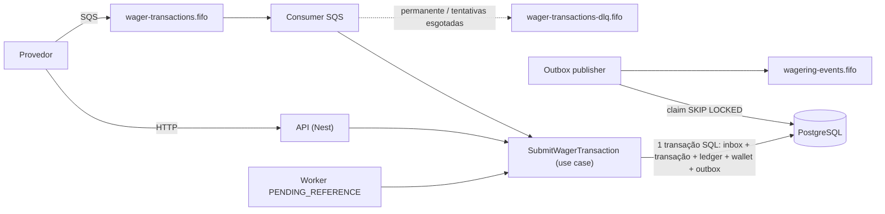

# ARCHITECTURE — Distributed Wagering Processor

> **Estado do documento:** decisões D01–D14 aprovadas em 2026-11-24; Fase 0 (spike e fundação) validada.
> Decisões convencionais estão na seção 3.

---

## 1. Contexto

Serviço financeiro que processa operações de apostas (`BET`, `WIN`, `LOSS`, `REFUND`, `ROLLBACK`) vindas de múltiplos provedores, por HTTP e por SQS, com entrega **at-least-once**: mensagens duplicadas, fora de ordem, concorrentes, crashes antes e depois do commit, e indisponibilidade temporária de PostgreSQL ou SQS.

**Objetivos, em ordem de prioridade:**
1. Correção financeira: nenhum débito ou crédito duplicado, saldo nunca negativo, `wallet.balance == Σ ledger`.
2. Correção sob concorrência entre N instâncias, com a wallet como unidade de concorrência.
3. Idempotência persistente.
4. Nenhum evento confirmado perdido; publicação somente após o commit.
5. Simplicidade e decisões explicáveis.

**Princípio central:** o PostgreSQL é a fonte da verdade de todas as invariantes. Código de aplicação, broker (FIFO/dedup) e locks são camadas de defesa e otimização. Toda garantia crítica tem um **backstop no schema** (constraint, índice único ou trigger).

**Fora de escopo deliberado:** autenticação real (ver D13), partidas dobradas, máquina de estados de rodada, reversão parcial e multi-moeda nos fluxos (o modelo é multi-moeda; os fluxos usam BRL).

### Visão de componentes

---

## 2. Decisões (ADR curto)

Legenda de status: **Proposta** (aguardando aprovação) · **Aprovada** · **Substituída**.

### D01 — Estratégia de concorrência por wallet
- **Status:** Aprovada (2026-11-24)
- **Contexto:** §5.6, §5.7, §6.2 e §8. É preciso evitar lost update e saldo negativo com N instâncias, sem lock global.
- **Decisão:** lock pessimista de linha (`SELECT … FROM wallets WHERE id = $1 FOR UPDATE`) no início da transação SQL, em `READ COMMITTED`, com `SET LOCAL lock_timeout`. Tentativa inicial com `FOR UPDATE NOWAIT` apenas para contabilizar contenção de lock, seguida do `FOR UPDATE` bloqueante. A coluna `version` continua sendo incrementada e é conferida no `UPDATE` (`WHERE version = $expected`) como defesa extra. `CHECK (balance >= 0)` é o último backstop.
- **Alternativas descartadas:** lock otimista com retry; `UPDATE` atômico condicionado; advisory lock por wallet.
- **Consequências:** serializa operações da mesma wallet (hot wallet limitada pela latência de uma transação) e mantém wallets diferentes em paralelo. Sem retry storm. `lock_timeout` vira erro transitório (503 / retry na fila).

### D02 — Mecânica e escopo da idempotência
- **Status:** Aprovada (2026-11-24)
- **Contexto:** §5.2, §6.3 e §9 (Idempotência), §7 regra 7.
- **Decisão:** a key fica em `wager_transactions` com `UNIQUE (provider_id, idempotency_key)`. O lookup acontece **depois** do lock da wallet. Violação de unicidade (`23505`) em corrida que não compartilha lock é capturada, a transação é refeita e o fluxo cai no replay ou no conflito. O resultado observado (`result_balance`, `result_wallet_version`) é gravado na própria transação para responder replays.
- **Alternativas descartadas:** chave global; tabela separada de idempotência com snapshot da resposta; claim prévio com `INSERT … ON CONFLICT`.
- **Consequências:** sem tabela extra e sem estado em memória. O replay devolve o estado atual da transação.

### D03 — Unicidade de reversões
- **Status:** Aprovada (2026-11-24)
- **Contexto:** §7 regras 3 e 4. A leitura literal ("pelo mesmo tipo") permitiria REFUND **e** ROLLBACK da mesma BET, ou seja, crédito duplo.
- **Decisão:** cada transação pode ser revertida **uma única vez, por qualquer tipo**. Índice único parcial: `UNIQUE (reference_transaction_id) WHERE kind IN ('REFUND','ROLLBACK') AND status = 'PROCESSED'`. Segunda tentativa → `REJECTED REFERENCE_ALREADY_REVERSED`.
- **Alternativas descartadas:** literal (`UNIQUE (reference_transaction_id, kind)`); permitir novo REFUND depois de um ROLLBACK do REFUND.
- **Consequências:** elimina crédito duplo por combinação de reversões. Interpretação mais restritiva que o texto literal, documentada como tal.

### D04 — Representação de `Money`
- **Status:** Aprovada (2026-11-24)
- **Contexto:** §5.1, §6.1, §13 e eliminatória "number para dinheiro".
- **Decisão:** internamente `bigint` em unidades menores (centavos, escala fixa 2), sem dependência externa. No banco, `NUMERIC(20,2)`. Contrato estrito: `^(0|[1-9]\d{0,17})\.\d{2}$`. Valor zero proibido em BET/WIN/REFUND/ROLLBACK, permitido em LOSS e `initialBalance`. Nunca arredondar: entradas inválidas são rejeitadas.
- **Alternativas descartadas:** `decimal.js` / `big.js`; `BIGINT` (centavos) no banco; formato de entrada leniente.
- **Consequências:** aritmética exata e trivial (só soma, subtração e comparação). Se um dia houver moedas com outra escala (JPY, BHD), o modelo precisa evoluir para escala por moeda.

### D05 — ORM e mapeamento domínio ↔ persistência
- **Status:** Aprovada (2026-11-24)
- **Contexto:** §4 (ORM), §6.0, §6.1 (domínio sem tipos do ORM).
- **Decisão:** **MikroORM 7** com `EntityManager.transactional()`. Entidades de persistência separadas do domínio (`WalletRecord`, `WagerTransactionRecord`…), definidas com `defineEntity`/`EntitySchema` (sem decorators) e com mappers explícitos que usam `rehydrate`. O lock é feito com `LockMode.PESSIMISTIC_WRITE`; SQL cru apenas onde o ORM não expressa (`SKIP LOCKED` com lease, agregações da reconciliação, `NOWAIT` para métrica).
- **Alternativas descartadas:** mapear o MikroORM direto sobre as classes de domínio; usar MikroORM apenas como QueryBuilder; TypeORM (mantido como fallback caso o spike F0 sob Bun falhe).
- **Consequências:** domínio 100% puro, ao custo de mappers. **Validado na F0:** MikroORM 7.2 + `@mikro-orm/nestjs` 7.1 + `defineEntity` + `Migrator` com registro estático de migrations funcionam sob Bun 1.2 (up/down reversível e `transactional()`).

### D06 — Garantias no schema
- **Status:** Aprovada (2026-11-24)
- **Contexto:** §5.5, §5.9 e §6.
- **Decisão:** além das constraints básicas, incluir os quatro reforços (R-a, R-b, R-c, R-d):
  - `wallets`: `UNIQUE (player_id, currency)`, `UNIQUE (id, currency)` (alvo de FK composta), `CHECK (balance >= 0)`, `CHECK (version >= 1)`, `CHECK (currency ~ '^[A-Z]{3}$')`, **trigger (R-b)** garantindo que `version` só incrementa (+1) junto com mudança de `balance`, e **constraint trigger diferida (R-c)** no commit exigindo um lançamento correspondente em `wallet_ledger_entries` (`wallet_version = NEW.version` e `balance_after = NEW.balance`) sempre que o saldo mudar.
  - `wager_transactions`: `UNIQUE (provider_id, idempotency_key)`, `UNIQUE (provider_id, external_transaction_id)`, `CHECK` de kind/status, `CHECK (kind NOT IN ('REFUND','ROLLBACK') OR reference_external_transaction_id IS NOT NULL)`, `CHECK ((status IN ('REJECTED','FAILED')) = (failure_code IS NOT NULL))`, `CHECK ((status = 'PROCESSED') = (processed_at IS NOT NULL))`, `CHECK ((kind = 'OPENING') = (provider_id = 'system'))`, índice parcial de reversão (D03), índice parcial `(next_attempt_at) WHERE status = 'PENDING_REFERENCE'`, **trigger (R-a)** bloqueando transição a partir de estado terminal e alteração de colunas imutáveis.
  - `wallet_ledger_entries`: FK composta `(wallet_id, currency) → wallets (id, currency)`, `UNIQUE (wallet_id, transaction_id)`, `UNIQUE (wallet_id, wallet_version)`, `CHECK (amount > 0)`, `CHECK (balance_before >= 0 AND balance_after >= 0)`, `CHECK` aritmético por direção, **trigger** que bloqueia `UPDATE`/`DELETE`/`TRUNCATE`.
  - `inbox_messages`: `PRIMARY KEY (consumer_name, message_id)`.
  - `outbox_messages`: PK = `eventId`, trigger de imutabilidade de `payload`/`event_type`, índice parcial `(next_attempt_at) WHERE published_at IS NULL`.
  - **Roles separadas (R-d):** role `migrator` dona do schema (executa migrations) e role `app` usada em runtime sem permissão de `UPDATE`/`DELETE`/`TRUNCATE` em `wallet_ledger_entries` e sem `ALTER`/`DDL`.
- **Consequências:** o banco recusa estados inválidos mesmo diante de bug ou código malicioso na app. Migrations exigem `down` simétrico para triggers e o Compose provê script de init com duas connection strings.

### D07 — Mapeamento de status HTTP e corpo de erro
- **Status:** Aprovada (2026-11-24)
- **Contexto:** §9 (Status HTTP).
- **Decisão:** `201` para `PROCESSED` recém-criado e `200` no replay idempotente (opção B); `202` `PENDING_REFERENCE` (novo ou replay enquanto pendente); `422` `REJECTED` (corpo com `transactionId`, `status`, `failureCode`, `balance`, `idempotentReplay`) e `WALLET_NOT_FOUND`; `400` payload inválido; `409` conflito (idempotência, `externalTransactionId`, wallet duplicada); `503` + `Retry-After` falha transitória; `404` recurso de path inexistente nos GETs; `500` bug. Corpo de erro único em todos os endpoints: `{ code, message, retryable, details?, transactionId?, status?, balance?, idempotentReplay? }`.
- **Alternativas descartadas:** `200` também para `PROCESSED` novo; `200` para `REJECTED` com status apenas no corpo.
- **Consequências:** o provedor distingue claramente criação (`201`) de replay (`200`) e todas as 5 classes de resultado sem parsear texto de erro. Nota: `201 → 200` no replay é um desvio explícito e documentado da leitura literal de "mesma resposta", mantendo o mesmo corpo (mudando apenas `idempotentReplay: true`).

### D08 — Emulador SQS
- **Status:** Aprovada (2026-11-24)
- **Contexto:** §4. Desde 23/03/2026, `localstack/localstack:latest` exige `LOCALSTACK_AUTH_TOKEN`.
- **Decisão:** **MiniStack** como padrão (open-source, sem conta/token, imagem `ghcr.io/ministackorg/ministack:latest`). Endpoint configurável (`SQS_ENDPOINT`) para compatibilidade com LocalStack; fallback documentado para `public.ecr.aws/localstack/localstack:4.4.0`.
- **Alternativas descartadas:** LocalStack `4.4.0` como padrão; LocalStack atual exigindo token.
- **Consequências:** setup sem atrito para o avaliador (`docker compose up` sem credenciais nem rate-limit do Docker Hub). **Validado na F0:** FIFO, `ChangeMessageVisibility`, `ApproximateReceiveCount` e `RedrivePolicy` para DLQ passaram no teste de contrato.

### D09 — Outbox com múltiplos publishers
- **Status:** Aprovada (2026-11-24)
- **Contexto:** §11.
- **Decisão:** claim em transação curta com `FOR UPDATE SKIP LOCKED` e **lease** (`locked_by`, `locked_until`, padrão 30s, lote 50); publicação fora da transação (timeout SDK 5s); marcação `published_at` condicionada ao dono do lease. Crash → lease expira → outra instância reassume. Falha → `scheduleRetry` (backoff exponencial com jitter). Destino: nova fila `wagering-events.fifo` (`MessageGroupId = aggregateId`, `MessageDeduplicationId = eventId`).
- **Alternativas descartadas:** manter a transação aberta durante a publicação; publisher único via advisory lock (líder); fila padrão não-FIFO.
- **Consequências:** nenhuma conexão do pool fica presa em I/O de rede. Duplicata possível somente em crash ou expiração do lease, segura porque o `eventId` é estável.

### D10 — Consumer SQS: classificação de erros, retry e DLQ
- **Status:** Aprovada (2026-11-24)
- **Contexto:** §10.
- **Decisão:** estratégia híbrida:
  - **Negócio** (transação persistida como `REJECTED`/`PROCESSED`/`PENDING_REFERENCE`, replay, `WALLET_NOT_FOUND`) → ack (`DeleteMessage`).
  - **Transitório** (PG indisponível, `lock_timeout`, deadlock, erro de rede) → sem ack; `ChangeMessageVisibility` com backoff exponencial baseado em `ApproximateReceiveCount`.
  - **Permanente** (JSON inválido, contrato inválido, `type` desconhecido, `OPENING`, conflito de idempotência, `messageId` na inbox com `payloadHash` diferente) → envio explícito à DLQ (`wager-transactions-dlq.fifo`) com motivo em `MessageAttributes` + delete.
  - Exaustão de transitórios: `RedrivePolicy` nativa com `maxReceiveCount = 5` envia à DLQ.
  - `SIGTERM`: para de buscar, aguarda as mensagens em voo até `SHUTDOWN_TIMEOUT_MS` e devolve as restantes com visibility `0`.
  - Uma única imagem com papéis ativáveis por `APP_ROLES=api,consumer,outbox,pending-worker`; `FAULT_INJECTION_POINT` (desligada por padrão, bloqueada em produção) para o teste conc. 5.
- **Alternativas descartadas:** deixar erros permanentes para o redrive nativo; substituir o redrive nativo por contagem manual no consumer.

### D11 — Política de PENDING_REFERENCE
- **Status:** Aprovada (2026-11-24)
- **Contexto:** §7.1.
- **Decisão:** backoff exponencial (1s, 2s, 4s… teto de 60s) + **TTL de 15 min** desde `created_at` (`expires_at`, configurável por env; curto nos testes). Esgotado → `REJECTED REFERENCE_NOT_FOUND` + `WagerTransactionRejected`. **Wake-up imediato:** ao commitar uma transação `PROCESSED`, dependentes em `PENDING_REFERENCE` com `(provider_id, reference_external_transaction_id)` correspondentes têm `next_attempt_at` antecipado para `now()` (apoiado por índice parcial). Retries intermediários não republicam `WagerTransactionPendingReference`.
- **Alternativas descartadas:** limite apenas por contagem de tentativas; polling sem wake-up.

### D12 — Algoritmo do `payloadHash`
- **Status:** Aprovada (2026-11-24)
- **Contexto:** §9 (Idempotência).
- **Decisão:** `SHA-256` (hex) sobre JSON canônico no estilo RFC 8785 (chaves ordenadas, sem espaços) dos campos `providerId`, `externalTransactionId`, `playerId`, `walletId`, `roundId`, `gameId`, `kind`, `money.amount`, `money.currency` e `referenceExternalTransactionId` (omitido quando ausente; `null` tratado como ausente). `amount` entra já validado no formato canônico. Campos desconhecidos no payload são **rejeitados** (`400` no HTTP / DLQ no SQS) para evitar zona cinzenta de comparação. Fora do hash: idempotency key, `messageId`, `type`, `occurredAt` e headers. O mesmo hasher atende HTTP e SQS. Inbox usa `SHA-256` do corpo bruto da mensagem SQS.

### D13 — Autenticação
- **Status:** Aprovada (2026-11-24)
- **Contexto:** §2 (não pontua na tabela da §14).
- **Decisão:** não implementar autenticação real nas fases centrais; manter `AuthGuard` no-op (aplicado globalmente, exceto `/health/*` e `/metrics`) e porta explícita `ProviderIdentityPort` (que em desenvolvimento retorna o `providerId` do corpo). Implementação real fica como opcional na F9 se sobrar tempo.
- **Desenho alvo (OIDC com Keycloak):** um *confidential client* por provedor (fluxo OAuth 2.0 `client_credentials`); JWT assinado validado via JWKS com cache no `AuthGuard`; claim `azp` (ou claim customizada `provider_id`) mapeada para o `ProviderIdentityPort`; autorização exigindo `body.providerId === identity.providerId` (403 em caso de divergência); escopos separados para leitura/reconciliação administrativa vs submissão de transações. Mensagens SQS seguem como canal interno confiável sujeito às validações de domínio (§2).
- **Alternativas descartadas:** integrar Keycloak ou Zitadel desde a F0/F3 (alto custo operacional para 0 pontos).

### D14 — Taxonomia de `failureCode`
- **Status:** Aprovada (2026-11-24)
- **Contexto:** §7.2.

| Categoria | Códigos | HTTP | Persistido | `retryable` |
|---|---|---|---|---|
| Contrato | `INVALID_PAYLOAD`, `INVALID_MONEY`, `UNSUPPORTED_KIND`, `REFERENCE_REQUIRED`, `REFERENCE_NOT_ALLOWED`, `IDEMPOTENCY_KEY_REQUIRED` | 400 | não | não (corrigir payload) |
| Conflito | `IDEMPOTENCY_KEY_CONFLICT`, `EXTERNAL_TRANSACTION_ID_CONFLICT`, `WALLET_ALREADY_EXISTS` | 409 | não | não |
| Negócio | `INSUFFICIENT_FUNDS`, `REVERSAL_INSUFFICIENT_FUNDS`, `CURRENCY_MISMATCH`, `WALLET_PLAYER_MISMATCH`, `REFERENCE_NOT_FOUND`, `REFERENCE_MISMATCH`, `REFERENCE_KIND_NOT_ALLOWED`, `REFERENCE_NOT_PROCESSED`, `REFERENCE_ALREADY_REVERSED`, `AMOUNT_MISMATCH` | 422 | sim (REJECTED) | não |
| Negócio sem persistência | `WALLET_NOT_FOUND` | 422 | não | sim, depois de criar a wallet |
| Transitório | `DATABASE_UNAVAILABLE`, `WALLET_BUSY` (`lock_timeout`), `SERVICE_UNAVAILABLE` | 503 | não | sim |
| Permanente de infra | `PROCESSING_FAILED` | — | sim (FAILED) | não |

---

## 3. Decisões convencionais (tomadas sem aprovação; contestáveis)

| Decisão | Justificativa |
|---|---|
| IDs UUIDv7 gerados na app (`Bun.randomUUIDv7()`) | Iguais aos exemplos do enunciado; localidade de índice; sem round-trip ao banco. |
| `timestamptz` em UTC em todas as datas | Sem ambiguidade de fuso. |
| snake_case no banco, camelCase no TS | Convenção de cada lado. |
| Logs com `pino` (JSON) + `AsyncLocalStorage` para o contexto | Padrão de mercado, rápido, compatível com Bun. |
| Métricas com `prom-client` em `GET /metrics` (sem auth) | Formato Prometheus é o padrão de fato. |
| `@aws-sdk/client-sqs` v3 | SDK oficial. |
| Validação de contrato com `zod` na camada de interface | Sem decorators e tipagem inferida; o domínio revalida as invariantes. |
| Infra de teste via Docker Compose (não Testcontainers) | O Compose já é obrigatório; evita risco de compatibilidade do Testcontainers com Bun. |
| `X-Correlation-Id` (gerado se ausente); no SQS, atributo de mensagem ou `messageId` | Rastreabilidade ponta a ponta. |
| Logs sem valores monetários, saldos, `playerId` ou payloads | §12: sem dados sensíveis ou financeiros completos. |
| Paginação do ledger com `limit` padrão 50 e máximo 200 | Protege o banco. |
| ESLint (typescript-eslint) com regra proibindo `parseFloat`/`Number()`/`number` em `Money` | Prova automatizada da R1. |

---

## 4. Trade-offs principais

| Escolha | Ganha | Perde |
|---|---|---|
| Lock pessimista por wallet | Determinismo, sem retries, simplicidade | Throughput por wallet limitado à latência de uma transação |
| Processamento síncrono no HTTP | Resposta final imediata e replay simples | Latência do HTTP inclui o lock |
| Backstops no schema (triggers) | Garantia mesmo com bug de código | Migrations mais complexas e escrita levemente mais lenta |
| Outbox com lease | Pool livre durante I/O | Duplicata possível em crash ou expiração de lease |
| Reversão única por referência (D03) | Elimina crédito duplo | Mais restritivo que o texto literal |
| Persistência separada do domínio | Domínio puro | Mappers e menos "mágica" de UoW sobre o domínio |

---

## 5. Limitações conhecidas (previstas)

- Hot wallet: throughput limitado pela serialização por wallet (decisão consciente).
- ROLLBACK antes da BET é tratado como "aguardar" e não como tombstone: se a BET chegar depois, ela é debitada e em seguida estornada.
- Não existe máquina de estados de rodada (WIN depois de LOSS, REFUND depois de WIN são aceitos se as regras da §7 permitirem).
- Escala monetária fixa em 2 casas para todas as moedas.
- Autenticação não implementada (D13).
- Reconciliação apenas sob demanda.
- Eventos com garantia at-least-once; a deduplicação é responsabilidade do consumidor via `eventId`.

---

## 6. Evoluções futuras

- Keycloak / OIDC com identidade de provedor vinculada ao token.
- Ledger de partidas dobradas (contas de casa e de provedor).
- Reconciliação agendada com alerta.
- Particionamento de `wager_transactions` e `ledger` por tempo; arquivamento da outbox publicada.
- OpenTelemetry (traces entre HTTP, SQS e outbox) e dashboard.
- Escala monetária por moeda (ISO-4217 minor units).
- Tombstone para reversões que chegam antes da referência, se o provedor exigir.
